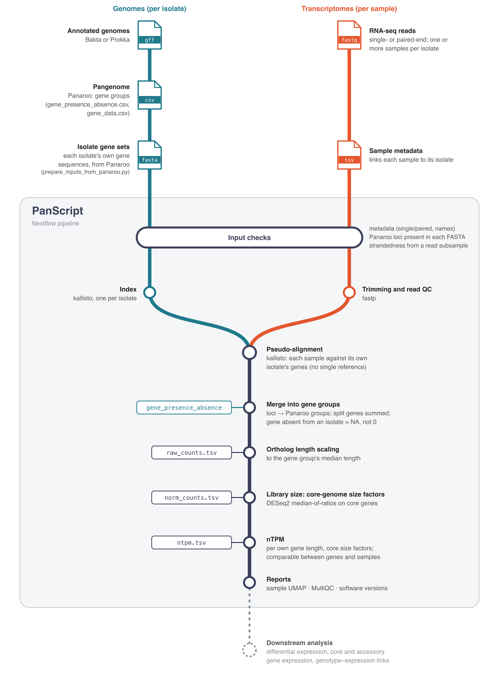

# PanScript

## Introduction

**PanScript** is a Nextflow pipeline for bacterial RNA-Seq analysis across genomically diverse isolates, without a single reference genome. Reads from each isolate are pseudo-aligned to that isolate's own gene set, and expression is merged across isolates through the orthologous gene groups of a [Panaroo](https://gthlab.au/panaroo/) pangenome.

## Pipeline summary

The pipeline requires the output from a pan-genome analysis with [`Panaroo`](https://gtonkinhill.github.io/panaroo/) and will perform the following steps:

1. Input checks: Panaroo loci missing from each isolate's FASTA, and library strandedness
2. Adaptor trimming and read QC ([`fastp`](https://github.com/OpenGene/fastp))
3. Pseudo-alignment to strain-specific gene sets ([`kallisto`](https://pachterlab.github.io/kallisto/))
4. Merging and length-scaling of counts for orthologous genes
5. Size-factor scaling of merged counts using the core genome ([`DESeq2`](https://bioconductor.org/packages/release/bioc/html/DESeq2.html)), and calculation of normalised TPM (nTPM)
6. Visualisation of gene expression across isolates ([`UMAP`](https://umap-learn.readthedocs.io/))
7. One QC report for the whole run ([`MultiQC`](https://multiqc.info/))

## Quick start

1. Install [Nextflow](https://www.nextflow.io/) (24.10.0 or later) and Docker, Singularity,
   Apptainer or conda.
2. Test your setup on the small test dataset:

       nextflow run adamd3/PanScript -profile test,docker --outdir test_results

3. Prepare your inputs: one gene FASTA per isolate, a metadata file, and Panaroo's
   `gene_presence_absence.csv`. `scripts/prepare_inputs_from_panaroo.py` makes the FASTAs and a
   metadata template from a Panaroo output directory (see [usage](docs/usage.md#inputs)).
4. Run the pipeline:

       nextflow run adamd3/PanScript -r v2.0.0 \
           --meta_file metadata.tsv \
           --gpa_file gene_presence_absence.csv \
           --outdir results \
           -profile docker

## Documentation

- [Usage](docs/usage.md): inputs, parameters, software profiles and running on a cluster.
  `--help` lists every parameter.
- [Output](docs/output.md): what each output file contains.
- [Normalisation](docs/normalisation.md): how the expression matrices are calculated, and why.

## Main outputs

`gene_counts/` holds three gene × sample matrices (one row per Panaroo gene group, `NA` where a gene
is absent from an isolate, linear scale):

- `raw_counts.tsv`: counts adjusted only for ortholog length differences between isolates.
- `norm_counts.tsv`: also normalised for library size with core-genome DESeq2 size factors. Compare
  the same gene across samples.
- `ntpm.tsv`: normalised TPM. Compare between genes and across samples.

`multiqc/multiqc_report.html` summarises read QC, pseudo-alignment rates and the input checks for
every sample. See [output](docs/output.md) for everything else.

## Citation

If you use PanScript, please cite it, using the Zenodo DOI
[10.5281/zenodo.24375403](https://doi.org/10.5281/zenodo.24375403) (all versions; each release
also has its own DOI on Zenodo) and the version you ran, and cite the tools it uses, listed in
[CITATIONS.md](CITATIONS.md). [CITATION.cff](CITATION.cff) has the details in a machine-readable
form (GitHub's "Cite this repository" button).
